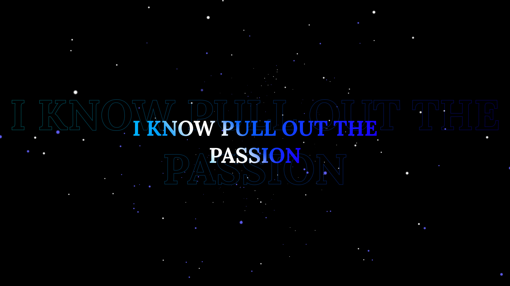
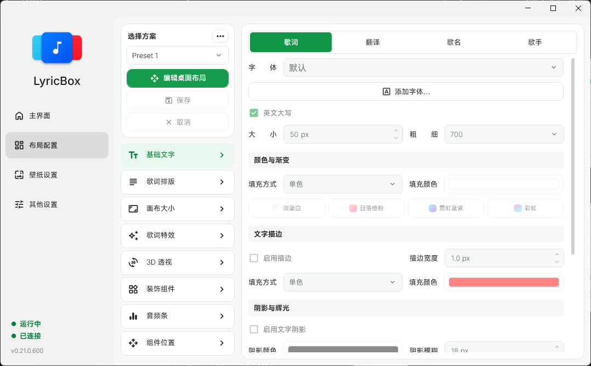

# LyricBox

让歌词漫过桌面

LyricBox 是一款Windows 桌面歌词应用  播放音乐时可以逐句高亮歌词  搭配翻译和音乐频谱  也可以用自己的图片或视频做壁纸

## 桌面版能做什么

| 功能 | 使用方式 |
| --- | --- |
| 桌面歌词 | 连接主流音乐播放器  选择单行或多行显示  有逐字时间信息的歌词可随播放进度扫光 |
| 歌词排版 | 分别设置原文和翻译的字体与颜色  调整它们在桌面上的位置  将常用布局保存为预设 |
| 壁纸 | 使用星空效果或选择本地图片与视频  开启壁纸摆动后可调整幅度和周期 |
| 音乐频谱 | 在桌面显示随音乐变化的频谱  搭配歌词和壁纸使用 |
| 界面语言 | 可以在桌面程序设置中切换 29 种界面语言 |

查看布局编辑器

## 用户数据

安装版将配置和缓存保存在 `%LOCALAPPDATA%\LyricBox\UserData`    便携版保存在程序旁的 `UserData` 文件夹    卸载时可选择保留或删除

## Windows 桌面版下载

> 当前桌面版本为 **1.0.4**  适用于 Windows x64    此页暂未提供安装包和便携包下载

| 下载入口 | 推荐人群 | 链接 |
| --- | --- | --- |
| 夸克网盘 | 使用夸克网盘的 Windows 用户 | [夸克网盘下载](https://pan.quark.cn/s/644ab82cac03) 提取码：5kQ8|
| 百度网盘 | 使用百度网盘的 Windows 用户 | [百度网盘下载](https://pan.baidu.com/s/1Y9ZXGQfQGsEBON1kSl8Z6Q?pwd=24s5) 提取码: 24s5|
| GitHub Release | 阅读版本说明或构建公开模块的开发者 | [LyricBox 1.0.4 ](https://github.com/djlove112/LyricBox/releases/tag/v1.0.4-source) |

## 开发者

在仓库上方打开 [src 源码目录](src) 可阅读歌词时间轴  桌面视觉效果和出厂布局    使用绿色 **Code → Download ZIP** 可下载当前分支

本次公开的 C# 模块可独立构建为类库    [查看源码导览与构建步骤](docs/BUILD.md)

## 授权

本仓库中的 LyricBox 自有源码按 **GPL-3.0-only** 发布    歌词与第三方素材的权利归各自权利人所有    [查看许可证全文](LICENSE)
